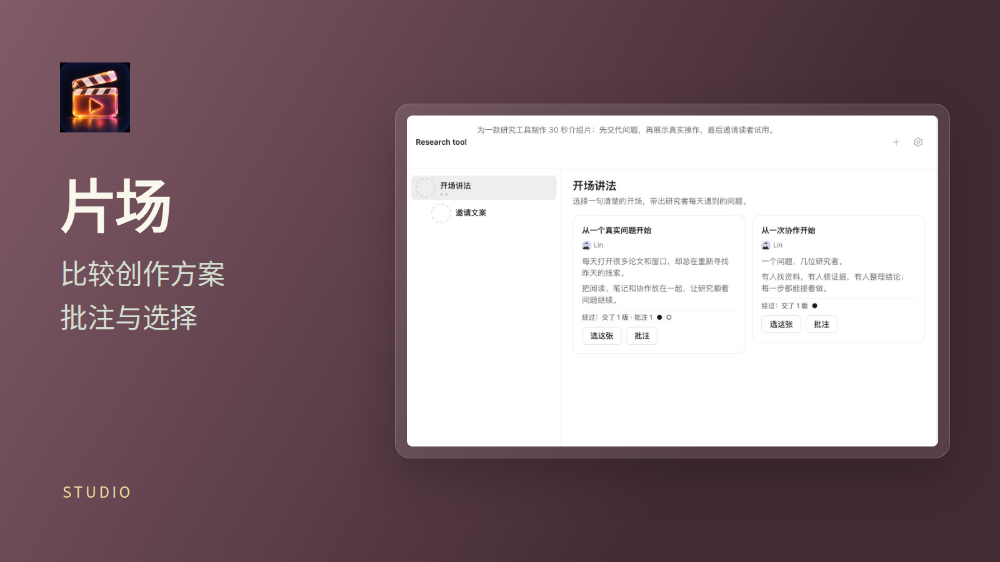
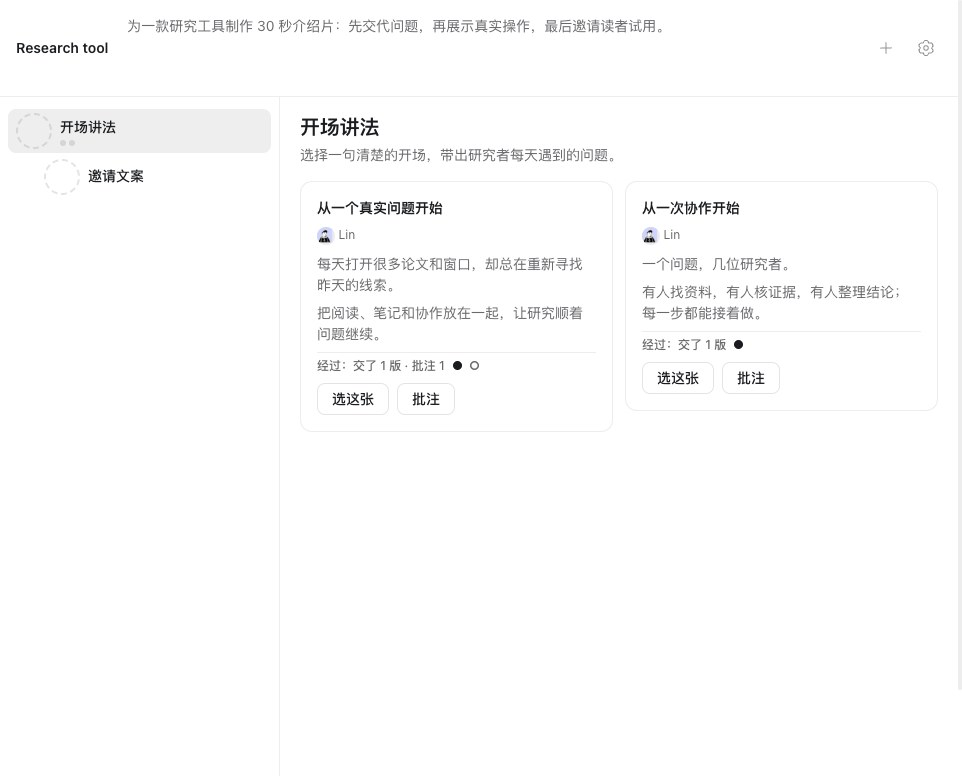
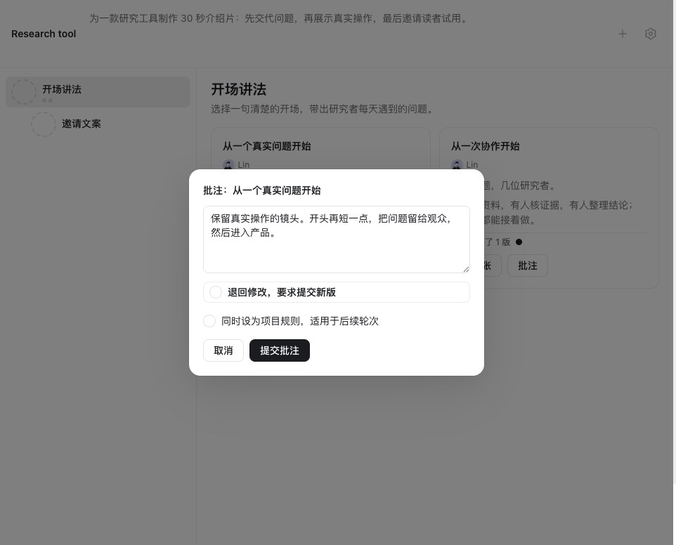

# 片场 · Studio

**在咕咕群里做片子：人说一句话，组长 agent 开一轮轮卡桌，几个不同模型的写手各交一版，人只管挑。**

1. 在群里跟组长说一句，比如「做条 15 秒的片子，介绍我们的记账小程序……分三轮：先出讲法，再挑声音，最后剪整片」。
2. 组长用片场开一张卡桌，排好几轮，每轮叫几个写手各交几张卡：讲法、文案、分镜、配音小样、整片……
3. 人在卡桌上看卡，可以批注、「选这张」或者打回。选中的卡会作为下一轮的参考。人也可以跳过一轮、暂停组长，或者自己开一轮。
4. 计划走完，组长在群里说一句片子做好了。

写手交片时，片场会先替人检查一遍：时长（不超过 10 分钟）、响度、最长无声、有没有黑屏或白屏。封面和缩略条由片场自动做。原片留在交卡的那台电脑上，卡桌上点一下就能播。

图像与配音使用在片场设置中配置的 OpenRouter 密钥，费用在卡桌顶部汇总。每张卡桌默认最多 8 轮，每轮最多 4 个写手，可在设置中调整。提交视频的设备需要安装 ffmpeg。需要咕咕 0.2.55 或更新版本。

片场需要的权限：读取群文件及各设备上任务工作区内的原片；写入群文件和当前设备的任务文件，用于保存卡桌、封面、缩略条与配音；发送群内通知；向 Agent 提供工具。跨设备的任务文件只读。安装时由权限确认单说明并请求授权。

要拍真产品的宣传片（录真实界面、剪成整片），组长和写手会照片场自带的拍片方法（promo-video skill）做，不用另外安装。

## License

MIT — see [LICENSE](LICENSE).
